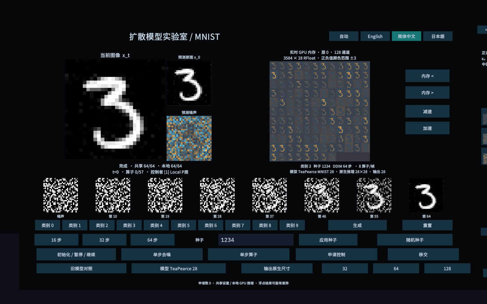
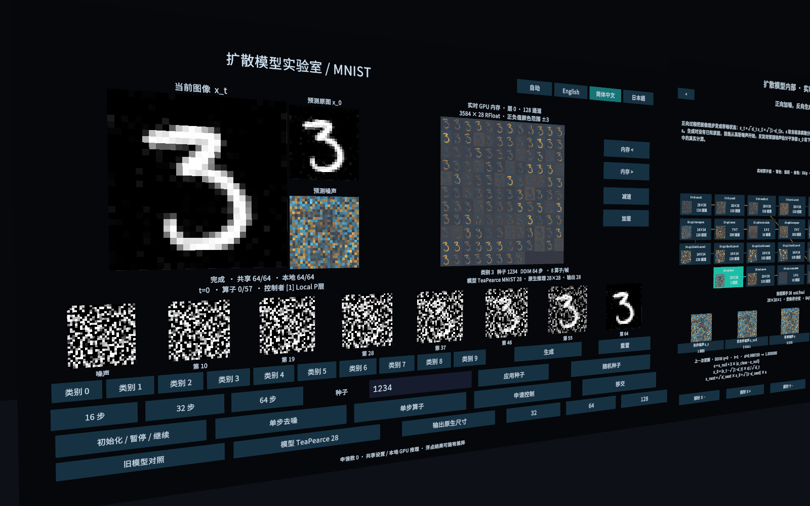
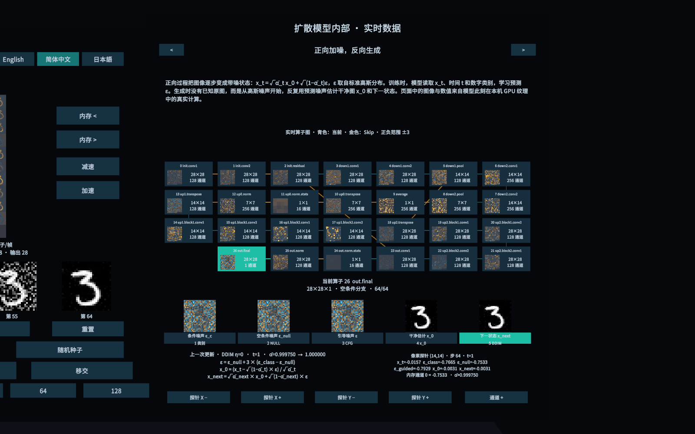

# VRChat Diffusion Lab

在 VRChat world 中观察并运行类别条件 MNIST 扩散模型。Udon 调度 fragment shader，通过 `VRCGraphics.Blit` 把算子结果写入本机 GPU 的 RFloat RenderTexture；各玩家同步生成配置和进度，各自在本机计算图像。

当前有两种可选模型：保留的 32×32 Legacy 小型模型，以及默认选中的 MIT TeaPearce 28×28 预训练模型。模型原生推理尺寸和输出显示尺寸分开标注；选择 32、64 或 128 输出只会最近邻放大，不会增加原生细节。完整架构、数据格式和同步边界见[模型设计](docs/model-design.md)。

Unity 工程位于 Windows 主机 `192.168.101.5` 的 `D:\Projects\VRChatProjects2\vrc-diffusion`，Linux 工作区是 Git 镜像。项目使用 Unity 2022.3.22f1 与 VRChat Worlds SDK 3.10.5。

## World 操作

1. 按 **REQUEST CONTROL** 申请控制权。没有控制者时会直接取得控制；已有控制者时会进入请求队列，由当前控制者按 **GRANT** 移交。
2. 选择 **MODEL**、数字类别、seed、16/32/64 步和 **OUTPUT** 尺寸，再按 **GENERATE**。Tea 默认 64 步，Legacy 默认 32 步。
3. **INIT / PAUSE / RUN** 初始化、暂停或继续。暂停后，**STEP OPERATOR** 前进一个 shader pass，**STEP DENOISE** 完成一个完整采样步。**RESET** 清空当前运行。
4. **MEM < / >** 切换当前算子层的实际特征图（显示该层各通道）；**SLOWER / FASTER** 调整每帧 shader pass 数量。
5. 教学板的左右箭头翻阅四页说明。**PROBE X/Y** 与 **CHANNEL +** 选择像素和特征通道，像素探针在采样步完成后读回真实 GPU 纹理数值。

主面板可用 **AUTO / English / 简体中文 / 日本語** 切换语言。AUTO 读取本机 VRChat 语言；手动语言覆盖只作用于本机。

## 模型概览

| 模型 | 原生尺寸 | 参数量 | shader 图 | 默认设置 |
| --- | ---: | ---: | ---: | --- |
| Legacy MNIST 32 | 32×32 | 146,177 | 11 个卷积层 | 32 步、[-1, 1]、预测裁剪 |
| TeaPearce MNIST 28 | 28×28 | 6,585,601 | 27 个算子 | 64 步、CFG=3、[0, 1]、不裁剪预测 |

Tea 权重来自 [TeaPearce/Conditional_Diffusion_MNIST](https://github.com/TeaPearce/Conditional_Diffusion_MNIST)，许可为 MIT；checkpoint commit、SHA-256 和导出图版本见[模型设计](docs/model-design.md)与[预训练调研](docs/pretrained-research.md)。本项目没有在这轮工作中重新训练该模型。

## 构建与部署

先结束 Play Mode，保存需要保留的场景编辑，再按顺序部署源码、编译 UdonSharp、建立基础场景、导入两种模型、生成教学板和本地化覆盖层。`BuildDiffusionLab.Build`、`BuildDiffusionModels.Import`、`BuildDiffusionTeaching.Apply` 和 `BuildDiffusionLocalization.Apply` 会保存它们构建的资产和场景；模型导入前需要干净且已保存的基础场景。不要在模型导入后再次运行基础 `Build`，因为它会重建场景。

```sh
python tools/deploy_sources.py --no-refresh
python tools/unity_remote.py recompile
python tools/unity_remote.py recompile_status
python tools/unity_remote.py run_script --file AgentScripts/BuildDiffusionLab.cs --entry BuildDiffusionLab.Compile
python tools/unity_remote.py run_script --file AgentScripts/BuildDiffusionLab.cs --entry BuildDiffusionLab.Build
python tools/unity_remote.py run_script --file AgentScripts/BuildDiffusionModels.cs --entry BuildDiffusionModels.Import
python tools/unity_remote.py run_script --file AgentScripts/BuildDiffusionTeaching.cs --entry BuildDiffusionTeaching.Apply
python tools/unity_remote.py run_script --file AgentScripts/BuildDiffusionLocalization.cs --entry BuildDiffusionLocalization.Apply
```

源码和场景由 [Unity Pipeline 技能](.agents/skills/unity-pipeline/SKILL.md)及 `tools/unity_remote.py` 管理。本轮已在 Unity Editor PlayMode 检查 UI 射线、三语切换、模型/输出控制、状态重放和实际 Udon 采样；未运行 SDK Build & Test，也未验证真实多客户端网络所有权交接。

## 验证状态

Tea 模型的 32、64、128 步 CPU 评估各包含 10 类 × 10 个 seed，共 100 张图。[64 步 CPU 样本网格](results/pretrained-quality-64.png)整体可辨，但不表示每个 seed 都清晰或类别正确。其中 10 个类别/seed 配对已用实际 shader hash 噪声和 D3D11 图计算交叉核对，[GPU 批次报告](results/gpu-seed-batch.json)标记通过；[图像](results/gpu-seed-batch.png)的最大误差为 `2.30669975e-5`，无 non-finite 值。

[两模型数值报告](results/models-numeric.json)标记通过，包含逐算子和完整采样轨迹对照：RTX 5080 / D3D11 下，Legacy 32 步最终 `maxAbs=4.45246696e-5`，Tea 64 步最终 `maxAbs=4.20212746e-6`。Tea 各中间节点也逐项核对。真实 Udon `VRCGraphics` 还以 class 3、seed 1234 完成了 Tea 64 步、65 帧运行，见[PlayMode 轨迹报告](results/play-trajectory.json)、[采样动画](results/pretrained-gpu-trajectory.gif)和[最终图像](results/pretrained-gpu-final.png)。运行期模型/输出/单步、陈旧快照、像素探针和教学公式结果记录在[运行报告](results/runtime.json)，报告标记通过。

UI 构建与 PlayMode 射线结果见[EditMode 报告](results/ui-editmode.json)和[PlayMode 报告](results/ui-playmode.json)，两份报告均标记通过：43 个按钮、2 个 world-space Canvas、462 个 TMP 文本覆盖层；三语切换、43 个按钮射线和 seed 草稿 400 ms 不丢失均有记录。中文 UI 和实时 RT 截图：







Legacy 保留作对比，不建议作为默认模型；旧版本样本曾有大量无效或难辨认输出，不能把少量变形的旧结论沿用到当前模型。PlayMode 已覆盖本地状态重放、陈旧快照和运行控制；真实多客户端的请求、所有权移交、晚加入和掉线恢复尚未实测。本轮没有进行 NPU 训练。

更多资料：[多人控制与追赶](docs/multiplayer-design.md)、[教学板设计](docs/teaching-design.md)、[射线 UI 参考](docs/ui-reference.md)、[预训练模型调研](docs/pretrained-research.md)。
